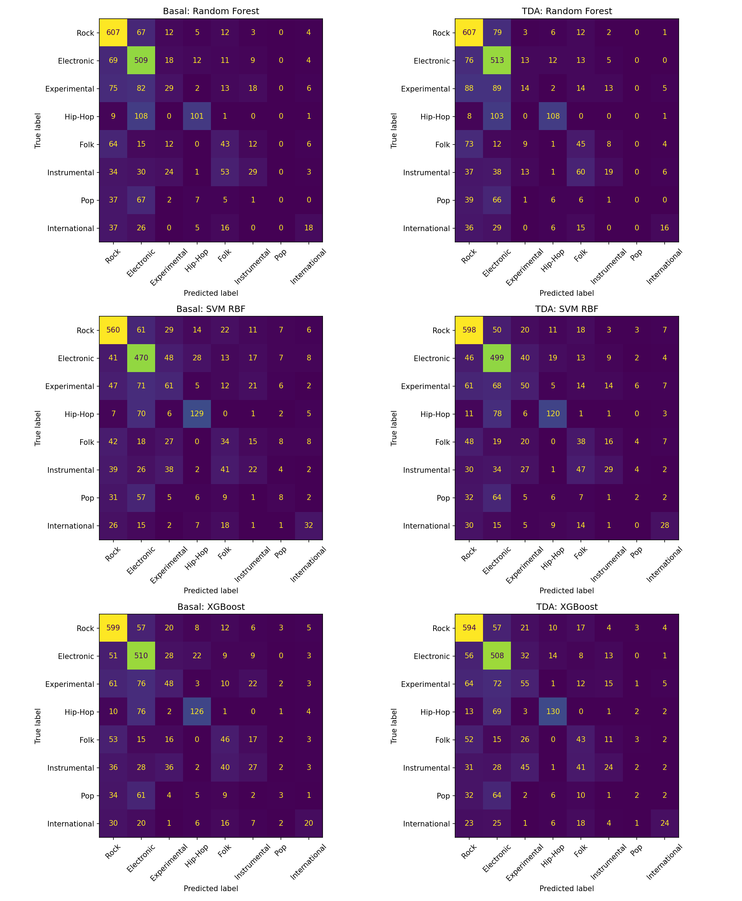

# Clasificación de géneros musicales mediante análisis topológico de datos

**Homología persistente · FMA · Random Forest · SVM · XGBoost**

Este repositorio reúne el código y los resultados de mi Trabajo Terminal de la Licenciatura en Ciencia de Datos en la UPIIT del Instituto Politécnico Nacional.

El objetivo es estudiar si la incorporación de características topológicas aporta información útil para clasificar géneros musicales. Para ello comparo modelos que utilizan descriptores acústicos con versiones que añaden imágenes de persistencia obtenidas a partir de nubes de MFCC.

## Contenido

Los notebooks se encuentran en la carpeta `notebooks` y conservan sus nombres originales. La carpeta `resultados` contiene los archivos obtenidos durante los experimentos.

| Archivo | Función |
| --- | --- |
| [modelo_basal.ipynb](modelo_basal.ipynb) | Extracción de atributos acústicos y evaluación de los clasificadores basales. |
| [Modelo_tda.ipynb](Modelo_tda.ipynb) | Cálculo de homología persistente, imágenes de persistencia y evaluación de los modelos aumentados. |
| [Comparacion.ipynb](Comparacion.ipynb) | Comparación de modelos, matrices de confusión, métricas por género y pruebas de McNemar con ajuste de Holm. |
| [resultados/](resultados/) | Atributos, métricas, predicciones y representaciones guardadas. |
| [requirements.txt](requirements.txt) | Dependencias para preparar el entorno de ejecución. |

## Datos y representación

Se utiliza una selección de **22 921 pistas** de FMA Medium, correspondiente a ocho géneros: Rock, Electronic, Experimental, Hip-Hop, Folk, Instrumental, Pop e International. Se mantienen las etiquetas de partición de FMA: 18 293 pistas de entrenamiento, 2 294 de validación y 2 334 de prueba.

El audio se procesa en mono a 22 050 Hz, con una duración máxima de 30 segundos, ventanas de 1 024 muestras y un salto de 512 muestras.

La representación acústica inicial contiene 16 atributos: las medias de 13 MFCC, centroide espectral, rolloff y tasa de cruces por cero. La ampliación incorpora 40 atributos adicionales, entre ellos estadísticas de MFCC y características de chroma, para obtener 56 atributos acústicos.

Para la representación topológica, cada ventana aporta un vector de 13 MFCC. Sobre esta nube se calcula homología persistente en dimensiones H₀ y H₁ mediante una filtración de Vietoris–Rips. Los diagramas se convierten en dos imágenes de persistencia de 20 × 20 píxeles, que añaden **800 atributos**. Así se comparan representaciones de **16 frente a 816** y de **56 frente a 856 atributos**.

## Experimentos

Se emplean Random Forest, SVM con kernel RBF y XGBoost. La selección de parámetros utiliza validación cruzada estratificada de cinco pliegues sobre entrenamiento y F1 ponderado. La semilla utilizada es 42.

| Configuración | Atributos acústicos | Pesos en RF/SVM | Árboles en RF/XGBoost | Representación topológica |
| --- | ---: | --- | ---: | --- |
| A_original | 16 | No | 100 | 800 atributos |
| B_atributos | 56 | No | 100 | 800 atributos |
| C_pesos | 56 | Sí | 100 | 800 atributos |
| D_arboles | 56 | Sí | 300 | 800 atributos |
| E_sin_pesos_300 | 56 | No | 300 | 800 atributos |
| F_pca_100 | 56 | No | 300 | Reducción de los 800 atributos a 100 mediante PCA |

Las configuraciones A–E permiten comparar atributos, pesos y número de árboles. F evalúa una reducción del bloque topológico. Las búsquedas de parámetros y los resultados de cada etapa se encuentran en los notebooks y en los CSV de validación cruzada.

## Resultados de la configuración E

Evaluación sobre las mismas **2 334 pistas de prueba**, utilizando 56 atributos acústicos en el basal y 856 en el modelo aumentado. Los valores proceden de [comparacion_final_test.csv](resultados/comparacion_final_test.csv).

| Clasificador | Exactitud basal | Exactitud + TDA | F1 ponderado basal | F1 ponderado + TDA |
| --- | ---: | ---: | ---: | ---: |
| Random Forest | 0.5724 | 0.5664 | 0.5225 | 0.5061 |
| SVM RBF | 0.5638 | 0.5844 | 0.5407 | 0.5499 |
| XGBoost | 0.5908 | 0.5913 | 0.5523 | 0.5548 |

En esta configuración, TDA mejora las métricas de SVM, reduce las de Random Forest y produce cambios pequeños en XGBoost. La comparación con las demás configuraciones muestra que el aporte depende del clasificador y de los parámetros empleados; estos resultados no permiten afirmar una mejora general por añadir información topológica.



### Archivos de resultados

| Archivos en `resultados/` | Contenido |
| --- | --- |
| `caracteristicas_basales.csv`, `caracteristicas_acusticas_56.csv` | Atributos acústicos por pista. El primero también contiene género y partición. |
| `basal_metricas_validation.csv`, `tda_metricas_validation.csv` | Evaluación inicial en validación. |
| `basal_predicciones_validation.csv`, `tda_predicciones_validation.csv` | Predicciones iniciales identificadas por `track_id`. |
| `comparacion_validation.csv`, `diferencias_validation.csv` | Comparación inicial de métricas. |
| `basal_experimento_cv.csv`, `tda_experimento_cv.csv` | Resúmenes de las configuraciones A–D. |
| `basal_ultima_cv.csv`, `tda_ultima_cv.csv`, `comparacion_E_cv.csv` | Resultados de las pruebas posteriores y comparación de E. |
| `*_folds.csv` | Resultados por pliegue de las evaluaciones que exportan este detalle. |
| `comparacion_final_test.csv`, `comparacion_final_predicciones_test.csv` | Métricas y predicciones de la configuración E en prueba. |
| `comparacion_f1_macro_test.csv`, `metricas_por_genero_test.csv` | F1 macro y métricas desglosadas por género. |
| `mcnemar_holm_test.csv` | McNemar exacto y ajuste de Holm para los tres clasificadores de la configuración E. |
| `tda_pi_train_validation.npz` | IDs, 800 atributos topológicos por pista y sigma de la representación inicial de entrenamiento/validación. |

El ajuste de Holm del CSV corresponde a **tres comparaciones**. La sección final del notebook evalúa por separado la propuesta de 16/816 atributos y muestra sus resultados dentro del propio notebook. Se conserva esa organización de las pruebas.

## Consultar los resultados

Los notebooks incluyen las salidas guardadas de los experimentos, y los CSV pueden consultarse directamente sin descargar los audios ni entrenar modelos. Los identificadores `track_id` permiten relacionar atributos y predicciones.

## Ejecutar el proyecto

### 1. Preparar Python

Los notebooks originales registran Python **3.10.20**, y la versión confirmada de **giotto-tda es 0.6.2**. Para crear un entorno independiente desde Anaconda Prompt:

```bash
conda create -n tda-musica python=3.10
conda activate tda-musica
python -m pip install -r requirements.txt
python -m ipykernel install --user --name tda-musica --display-name "Python (tda-musica)"
```

Ejecuta estos comandos desde la carpeta del repositorio. `requirements.txt` propone restricciones para preparar el entorno; no constituye un registro completo de las versiones utilizadas en los experimentos originales. La instalación y el entrenamiento completo deben comprobarse en el equipo donde se reproduzca el proyecto.

### 2. Preparar FMA

Descarga los audios de `fma_medium.zip` y los metadatos de `fma_metadata.zip` desde el [repositorio oficial de FMA](https://github.com/mdeff/fma#data).

De forma predeterminada, los notebooks buscan `fma_metadata/tracks.csv` y rutas como `fma_medium/000/000002.mp3` dentro de la carpeta del proyecto. Si los archivos están en otro disco, define las siguientes variables antes de abrir Jupyter. Por ejemplo, en PowerShell con el entorno activado:

```powershell
$env:FMA_AUDIO_DIR = "D:\Datos\fma_medium"
$env:FMA_METADATA_DIR = "D:\Datos\fma_metadata"
jupyter lab
```

Las rutas deben apuntar a las carpetas que contienen directamente las subcarpetas de audio y `tracks.csv`, respectivamente. También pueden editarse las asignaciones `AUDIO_DIR` y `METADATA_DIR` en las celdas de configuración.

### 3. Ejecutar los notebooks en orden

Abre Jupyter desde la raíz del repositorio y selecciona el kernel **Python (tda-musica)**. Ejecuta cada notebook de principio a fin:

1. **modelo_basal.ipynb:** prepara los atributos y las evaluaciones acústicas. Los CSV incluidos permiten reutilizar los atributos ya extraídos.
2. **Modelo_tda.ipynb:** calcula los diagramas de entrenamiento y validación, construye las imágenes de persistencia y evalúa los modelos aumentados.
3. **Comparacion.ipynb:** compara las evaluaciones, calcula los diagramas de prueba que falten y realiza los análisis finales.

Los **22 921 diagramas individuales** no se distribuyen en el repositorio. Se generan en `resultados/diagramas_tda/` y el código reutiliza los archivos existentes. Si ya se dispone de esa carpeta del proyecto original, puede copiarse en esa ubicación para evitar recalcularlos. El archivo NPZ incluido no sustituye los diagramas necesarios para las evaluaciones por pliegue.

Los notebooks escriben sus resultados en `resultados/`; una nueva ejecución puede reemplazar los CSV incluidos. Para comparar una reproducción con los resultados originales, conserva una copia antes de ejecutar. Si cambias los parámetros de extracción, utiliza una copia separada del proyecto sin los atributos ni los diagramas previos, para evitar reutilizar representaciones de otra configuración.

## Alcance y reproducibilidad

Las clases están desbalanceadas y los pliegues se estratifican por género, sin agrupación por artista. McNemar evalúa cambios en los aciertos globales, no diferencias de F1 ni de rendimiento por género. La independencia entre pistas del mismo artista o álbum no se modela en estas pruebas.

La evaluación inicial del modelo aumentado utiliza una representación topológica ajustada con todo `training` antes de la validación cruzada de los clasificadores. Las comparaciones posteriores A–F ajustan las imágenes de persistencia dentro de cada pliegue. Esta diferencia debe tenerse en cuenta al interpretar las evaluaciones.

El conjunto de prueba aparece en más de una sección de comparación. El repositorio conserva esas etapas y sus resultados como registro del trabajo experimental; no demuestra por sí mismo una evaluación confirmatoria con una única consulta al conjunto de prueba.

Para publicar el código se sustituyeron las rutas absolutas del equipo por rutas relativas y variables de entorno. Se retiraron las salidas de advertencias de `stderr` para facilitar la lectura. Los cálculos, las celdas de análisis y los archivos de resultados se conservaron.

## Autor

**Rodrigo Félix Palmeros**  
Licenciatura en Ciencia de Datos · UPIIT · Instituto Politécnico Nacional  
Trabajo Terminal: **TT2026-2_LCD02**

**Asesores:** Dr. Jesús Rogelio Pérez Buendía y Mtro. Lenin Augusto Echavarría Cepeda.

Los datos proceden de **FMA: A Dataset for Music Analysis**, de Michaël Defferrard, Kirell Benzi, Pierre Vandergheynst y Xavier Bresson (ISMIR, 2017). Los audios y los metadatos se obtienen de su [repositorio oficial](https://github.com/mdeff/fma).
